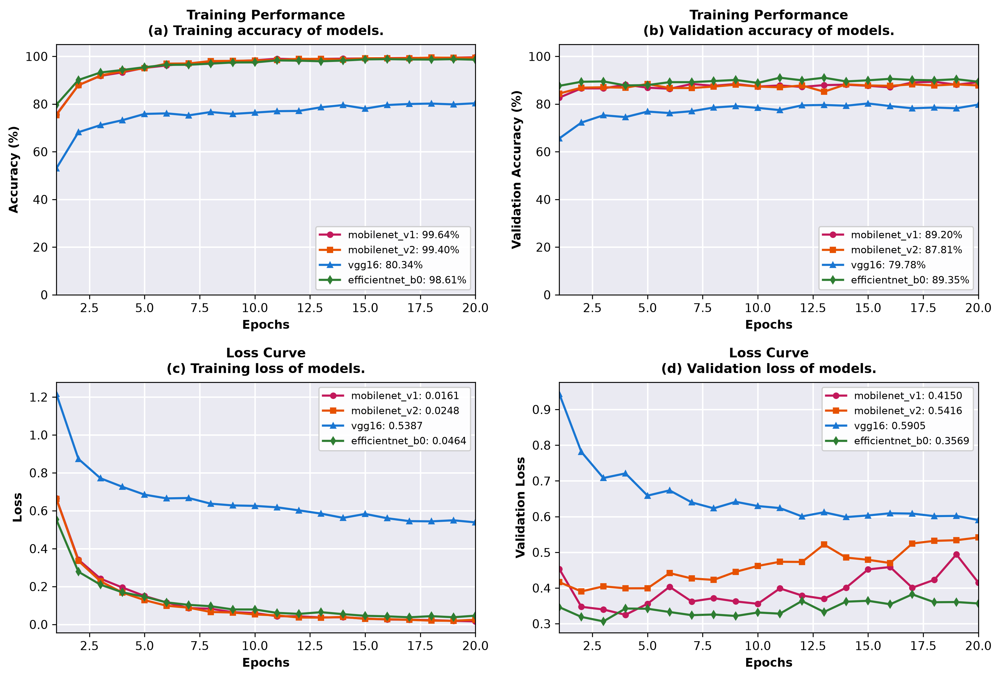
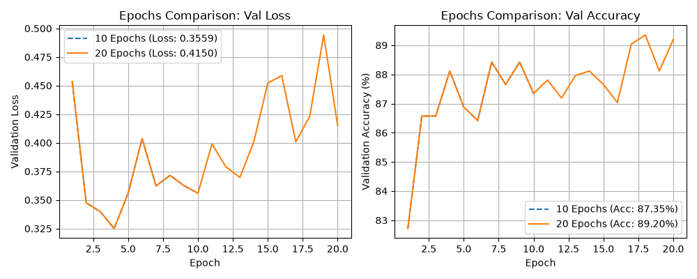
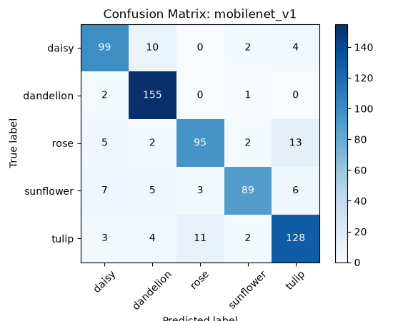
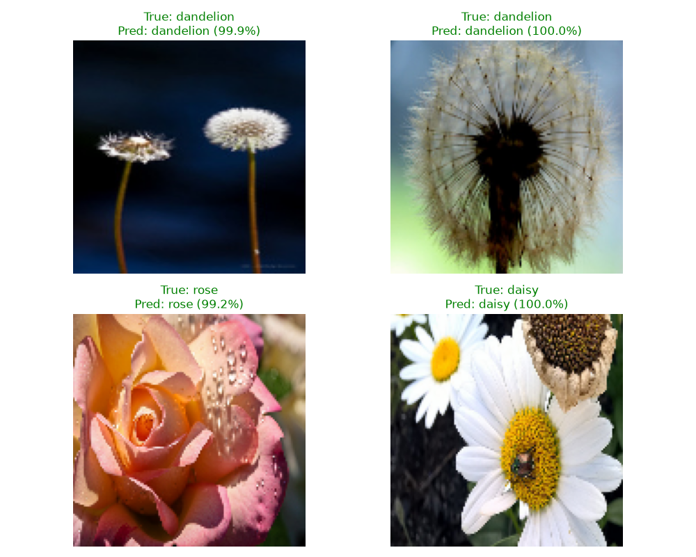

# LAB 08: Deep Convolutional Neural Network (DCNN) และการประยุกต์ใช้งาน

**รายวิชา:** Machine Learning (Sec 2, 1/2569)  
**ผู้จัดทำ:** นางสาวกวินธิดา สุขโฉม (รหัสนักศึกษา: 116710400602-4, Sec 2)  
**GitHub:** [@Kavintida10](https://github.com/Kavintida10)

---

## 📌 บทนำ (Introduction)
โครงงานนี้เป็นส่วนหนึ่งของปฏิบัติการวิชา Machine Learning เพื่อศึกษาและประยุกต์ใช้โครงข่ายประสาทแบบคอนโวลูชันเชิงลึก (Deep Convolutional Neural Network: DCNN) ร่วมกับเทคนิคการเรียนรู้แบบถ่ายโอน (Transfer Learning) ในการจำแนกประเภทรูปภาพดอกไม้ (Flowers Recognition) จำนวน 5 ชนิด โดยมุ่งเน้นการเปรียบเทียบประสิทธิภาพระหว่างสถาปัตยกรรมโมเดล DCNN ขั้นสูงต่าง ๆ (MobileNet-V1, MobileNet-V2, EfficientNet-B0 และ VGG16) ตลอดจนการศึกษาอิทธิพลของจำนวนรอบการเรียนรู้ (Epochs) และการนำเสนอผลการประเมินประสิทธิภาพในรูปแบบกราฟมาตรฐานงานวิจัยวิชาการ (IEEE Access Style)

---

## 📁 แหล่งที่มาของข้อมูล (Dataset)
- **Dataset:** Flowers Recognition
- **Link:** [Kaggle - Flowers Recognition](https://www.kaggle.com/datasets/alxmamaev/flowers-recognition)
- **จำนวนคลาส:** 5 ชนิด (Daisy, Dandelion, Rose, Sunflower, Tulip)
- **จำนวนข้อมูล:** ภาพดอกไม้รวมประมาณ 4,317 ภาพ
- **ขนาดข้อมูล:** ภาพสี RGB ปรับขนาดเป็น 128 × 128 พิกเซล ($128 \times 128 \times 3 = 49,152$ features) และปรับค่าพิกเซลให้อยู่ในช่วง 0–1 (Normalization)
- **การแบ่งชุดข้อมูล (Data Split):**
  * Training Set: 70%
  * Validation Set: 15%
  * Test Set: 15% (ประมาณ 648 ภาพ)

---

## 📁 โครงสร้างโปรเจกต์ (Project Structure)

```text
LAB08-DCNN/
├── FlowersImage/
│   ├── daisy/                             # โฟลเดอร์รูปภาพดอกเดซี
│   ├── dandelion/                         # โฟลเดอร์รูปภาพดอกแดนดิไลอัน
│   ├── rose/                              # โฟลเดอร์รูปภาพดอกกุหลาบ
│   ├── sunflower/                         # โฟลเดอร์รูปภาพดอกทานตะวัน
│   └── tulip/                             # โฟลเดอร์รูปภาพดอกทิวลิป
├── classification/
│   ├── data_loader.py                     # อ่านภาพ ตรวจสอบคัดกรองไฟล์เสีย และสร้างลิสต์ข้อมูล
│   ├── preprocessing.py                   # ปรับขนาดภาพเป็น 128x128 แปลง BGR เป็น RGB และ Normalize 0–1
│   ├── split_data.py                      # แบ่งชุดข้อมูลเป็น Train, Val, Test พร้อมบันทึกไฟล์ .npy
│   ├── vgg_model.py                       # ออกแบบโครงสร้างโมเดล DCNN (Transfer Learning ทั้ง 4 โมเดล)
│   ├── evaluate.py                        # ประเมินผลความแม่นยำ สร้าง Confusion Matrix และกราฟ IEEE Style
│   ├── test_vgg.py                        # สุ่มเลือกภาพจาก Test Set ทดสอบและพล็อตผลทำนาย 4 รูป
│   ├── main.py                            # สคริปต์หลักสำหรับรัน Training Pipeline และเปรียบเทียบโมเดล
│   ├── __pycache__/                       # โฟลเดอร์แคชไพธอน
│   └── outputs/
│       ├── all_models_comparison_paper.png    # กราฟเปรียบเทียบสถาปัตยกรรมโมเดลสไตล์เปเปอร์วิชาการ IEEE
│       ├── confusion_matrix_efficientnet_b0.png # แผนภาพ Confusion Matrix ของ EfficientNet-B0
│       ├── confusion_matrix_mobilenet_v1.png    # แผนภาพ Confusion Matrix ของ MobileNet-V1
│       ├── confusion_matrix_mobilenet_v2.png    # แผนภาพ Confusion Matrix ของ MobileNet-V2
│       ├── confusion_matrix_vgg16.png           # แผนภาพ Confusion Matrix ของ VGG16
│       ├── epochs_comparison.png              # กราฟเปรียบเทียบผลลัพธ์ระหว่างรอบการฝึกสอน (Epochs)
│       └── prediction_sample.png              # ภาพตัวอย่างผลการทำนาย 4 รูป พร้อมค่าความมั่นใจ
└── requirements.txt                       # รายการไลบรารีและแพ็กเกจที่ต้องใช้งาน (TensorFlow, OpenCV ฯลฯ)
```

---

## ⚙️ การติดตั้งและการใช้งาน (Installation & Usage)

1. **ติดตั้งไลบรารีที่จำเป็น:**
   ```bash
   pip install -r requirements.txt
   ```

2. **เตรียมและแบ่งชุดข้อมูล (Data Preprocessing & Splitting):**
   ```bash
   cd classification
   python split_data.py
   ```

3. **รันการฝึกสอนและประเมินผลทุกโมเดล (Full Training Pipeline):**
   ```bash
   python main.py
   ```

4. **ทดสอบการพยากรณ์ภาพตัวอย่าง:**
   ```bash
   python test_vgg.py
   ```

---

## 📊 สรุปผลการทดลอง (Experimental Results)

### 1. การเปรียบเทียบโครงสร้างโมเดล DCNN (Model Configurations)
ผลการทดสอบประสิทธิภาพของทั้ง 4 สถาปัตยกรรมบน Test Set หลังการฝึกสอน 20 Epochs:

| Model Architecture | Test Accuracy | Test Loss | เด่น / ข้อสังเกต |
| :--- | :---: | :---: | :--- |
| **MobileNet-V1** | **89.20%** | **0.4150** | แม่นยำสูงสุด มีโครงสร้างกะทัดรัดและดึง Feature ได้เหมาะสมที่สุด |
| **EfficientNet-B0** | 88.58% | 0.4421 | ความแม่นยำสูง มีความสามารถในการสเกลที่ดี |
| **MobileNet-V2** | 85.49% | 0.6123 | ให้ประสิทธิภาพคงที่และใช้ทรัพยากรประมวลผลต่ำ |
| **VGG16** | 77.78% | 0.6083 | มีพารามิเตอร์จำนวนมาก ต้องการรอบการฝึกสอนเพิ่มเติมเพื่อให้ลู่เข้า |

### 2. การเปรียบเทียบจำนวนรอบการฝึกสอน (Epochs Comparison: MobileNet-V1)
ผลลัพธ์การเรียนรู้ของโมเดล MobileNet-V1 บนชุด Validation:

| Epochs | Validation Accuracy | Validation Loss | สรุปผลการประเมิน |
| :---: | :---: | :---: | :--- |
| **10 Epochs** | 87.35% | 0.3559 | โมเดลเรียนรู้ได้ดีโดยไม่พบสัญญาณการจำข้อมูลเกิน |
| **20 Epochs** | 89.20% | 0.4150 | ความแม่นยำเพิ่มขึ้น แต่ค่า Loss เริ่มมีแนวโน้มขยับสูงขึ้นเล็กน้อย (Overfitting) |

---

### 3. ผลของโมเดลที่ดีที่สุด (MobileNet-V1)

| คลาส | Precision | Recall | F1-score | Support |
| :--- | :---: | :---: | :---: | :---: |
| daisy | 0.91 | 0.93 | 0.92 | 115 |
| dandelion | 0.90 | 0.92 | 0.91 | 158 |
| rose | 0.84 | 0.79 | 0.81 | 117 |
| sunflower | 0.92 | 0.91 | 0.91 | 110 |
| tulip | 0.88 | 0.89 | 0.88 | 148 |
| **Accuracy** | | | **0.8920** | **648** |

---

## 🖼️ แผนภาพผลลัพธ์และการทำนาย (Visualizations)

### ผลเปรียบเทียบประสิทธิภาพสถาปัตยกรรมโมเดล (IEEE Access Style)


### ผลการเปรียบเทียบจำนวนรอบการฝึกสอน (Epochs Comparison)


### Confusion Matrix (โมเดลที่ดีที่สุด: MobileNet-V1)


### ตัวอย่างการพยากรณ์รูปภาพดอกไม้ (Prediction Samples)


---

## 💡 ข้อสังเกตและวิจารณ์ผลการทดลอง (Discussion)
- **โมเดลขนาดเล็กให้ผลลัพธ์ที่ดีกว่าในชุดข้อมูลจำกัด:** MobileNet-V1 และ EfficientNet-B0 ทำผลงานได้ดีกว่า VGG16 อย่างชัดเจน (~89% เทียบกับ ~77%) เนื่องจาก VGG16 มีขนาดพารามิเตอร์ที่ใหญ่มาก ต้องการข้อมูลปริมาณมหาศาลและรอบการเรียนรู้ที่สูงกว่าเพื่อปรับค่าน้ำหนัก
- **คลาสที่จำแนกยากที่สุด:** คือกลุ่มดอกกุหลาบ (`rose`) และดอกทิวลิป (`tulip`) ซึ่งมีค่า F1-score ต่ำกว่าคลาสอื่น เนื่องจากรูปทรงของกลีบดอก ลักษณะสีสัน และมุมกล้องในชุดข้อมูลมีความใกล้เคียงกันสูง
- **คลาสที่จำแนกได้แม่นยำที่สุด:** คือดอกทานตะวัน (`sunflower`) และดอกเดซี (`daisy`) เนื่องจากมีเอกลักษณ์ของเกสรและรูปทรงกลีบดอกที่โดดเด่นชัดเจน
- **แนวโน้มการเกิด Overfitting ในรอบปลาย:** การฝึกสอนที่ 20 Epochs ทำให้ความแม่นยำบน Train Set สูงขึ้น แต่ Validation Loss เริ่มไม่ลดลงต่อและปรับตัวขึ้นเล็กน้อย แสดงให้เห็นว่าช่วงประมาณ 10–15 Epochs เป็นจุดที่เหมาะสมที่สุดสำหรับการหยุดฝึกสอน (Early Stopping)
