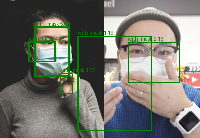
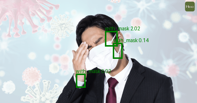
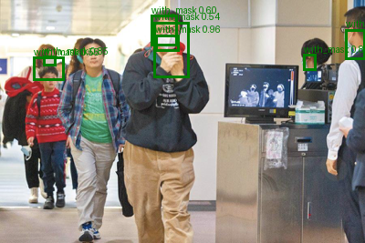

# ML-09: Object Detection I — R-CNN และ Fast R-CNN สำหรับการตรวจจับหน้ากากอนามัย

**รายวิชา:** Machine Learning ([ใส่ Sec / ภาคเรียน])  
**ผู้จัดทำ:** [นางสาวกวินธิดา สุขโฉม] (รหัสนักศึกษา: [116710400602-4])  
**GitHub:** [ใส่ลิงก์ ถ้ามี]

---

## 📌 บทนำ (Introduction)
โครงงานนี้เป็นส่วนหนึ่งของปฏิบัติการวิชา Machine Learning เพื่อศึกษาการตรวจจับวัตถุ (Object Detection) ด้วยสถาปัตยกรรมตระกูล R-CNN โดยนำ **R-CNN** และ **Fast R-CNN** มาตรวจจับการสวมหน้ากากอนามัยจากรูปภาพและกล้องเว็บแคม แล้วเปรียบเทียบประสิทธิภาพ (AP/mAP) และความเร็วของทั้งสองวิธี

---

## 📁 แหล่งที่มาของข้อมูล (Dataset)
- **Dataset:** Face Mask Detection (โดย andrewmvd)
- **Link:** [Kaggle - Face Mask Detection](https://www.kaggle.com/datasets/andrewmvd/face-mask-detection)
- **ใบอนุญาต:** CC0: Public Domain
- **จำนวนคลาส:** 3 คลาส (`with_mask`, `without_mask`, `mask_weared_incorrect`)
- **จำนวนข้อมูล:** 853 รูป (ไฟล์เฉลยต้นฉบับเป็น Pascal VOC `.xml`)
- **การเตรียมข้อมูล:** แปลง `.xml` เป็นรูปแบบ YOLO (`class x_center y_center w h` ค่าอยู่ระหว่าง 0–1) ด้วย `prepare_data.py`
- **การแบ่งชุดข้อมูล (Data Split, seed = 42):**
  * Training Set: 70% (597 รูป)
  * Validation Set: 15% (128 รูป)
  * Test Set: 15% (128 รูป) มีวัตถุจริง 551 ชิ้น (with_mask 461, without_mask 74, mask_weared_incorrect 16)

---

## 📁 โครงสร้างโปรเจกต์ (Project Structure)

```text
ML-09-Object-Detection-I/
├── dataset/
│   ├── train/{images,labels}/       # ชุดฝึก 597 รูป
│   ├── val/{images,labels}/         # ชุดตรวจสอบ 128 รูป
│   ├── test/{images,labels}/        # ชุดทดสอบ 128 รูป
│   └── data.yaml                    # path และชื่อคลาส
├── prepare_data.py                  # แปลง .xml เป็น YOLO .txt และแบ่ง train/val/test
├── check_labels.py                  # วาดกรอบทับรูปเพื่อตรวจว่าการแปลงถูกต้อง
├── 01-R-CNN/
│   ├── train.py                     # Selective Search + ResNet18 feature + LinearSVC + Ridge
│   ├── evaluate.py                  # คำนวณ AP, Precision, Recall, mAP บนชุด test
│   ├── image_test.py                # ตรวจจับรูปเดี่ยวและวาดกรอบผลทำนาย
│   ├── realtime_test.py             # ตรวจจับจากกล้องเว็บแคม (กด SPACE ทีละเฟรม)
│   └── outputs/
│       ├── rcnn_head.joblib         # โมเดลที่ฝึกแล้ว (SVM + Ridge)
│       ├── eval_results.txt         # ผลประเมินบนชุด test
│       └── pred_*.png               # ภาพตัวอย่างผลทำนาย
├── 02-Fast-R-CNN/
│   ├── train.py                     # ResNet18 feature map + RoI Pooling + FC head (cls + bbox)
│   ├── evaluate.py                  # คำนวณ AP, Precision, Recall, mAP บนชุด test
│   ├── image_test.py                # ตรวจจับรูปเดี่ยวและวาดกรอบผลทำนาย
│   ├── realtime_test.py             # ตรวจจับจากกล้องเว็บแคม (SPACE / โหมดอัตโนมัติ)
│   └── outputs/
│       ├── fast_rcnn_head.pt        # น้ำหนักส่วนหัวของโมเดลที่ฝึกแล้ว
│       ├── eval_results.txt         # ผลประเมินบนชุด test
│       ├── proposals_cache/         # แคชกรอบเสนอจาก Selective Search
│       └── pred_*.png               # ภาพตัวอย่างผลทำนาย
├── requirements.txt                 # รายการไลบรารีที่ต้องใช้
└── README.md
```

---

## ⚙️ การติดตั้งและการใช้งาน (Installation & Usage)

ทดสอบบน Python 3.13 (Windows) ด้วย CPU

1. **ติดตั้งไลบรารีที่จำเป็น:**
   ```bash
   pip install -r requirements.txt
   ```

2. **เตรียมข้อมูล:** ดาวน์โหลดข้อมูลจาก Kaggle ตามลิงก์ด้านบน แล้ววางที่ `raw/images` และ `raw/annotations` (โฟลเดอร์ `raw/` ไม่ได้แนบมากับโปรเจกต์) จากนั้นรัน
   ```bash
   python prepare_data.py
   python check_labels.py        # (ทางเลือก) ตรวจกรอบที่แปลงแล้ว
   ```

3. **R-CNN:**
   ```bash
   python 01-R-CNN/train.py
   python 01-R-CNN/evaluate.py
   python 01-R-CNN/image_test.py ["path/to/image.png"]
   python 01-R-CNN/realtime_test.py        # SPACE = ตรวจจับ, Q/ESC = ออก
   ```

4. **Fast R-CNN:**
   ```bash
   python 02-Fast-R-CNN/train.py
   python 02-Fast-R-CNN/evaluate.py
   python 02-Fast-R-CNN/image_test.py ["path/to/image.png"]
   python 02-Fast-R-CNN/realtime_test.py   # SPACE = ตรวจจับ, A = โหมดอัตโนมัติ, Q/ESC = ออก
   ```

> หมายเหตุ: ต้องรัน `python ...` จากโฟลเดอร์หลักของโปรเจกต์ ถ้าไม่ระบุรูป `image_test.py` จะสุ่มรูปจากชุด test

---

## 📊 สรุปผลการทดลอง (Experimental Results)

### 1. การตั้งค่าของทั้งสองโมเดล (Model Configurations)

| รายการ | R-CNN | Fast R-CNN |
| :--- | :--- | :--- |
| กรอบเสนอ | Selective Search (โหมดเร็ว) 200 กรอบ/รูป | เหมือนกัน |
| สกัด feature | ตัดแต่ละกรอบแล้วส่งเข้า ResNet18 (ล็อกน้ำหนัก) ทีละกรอบ | ส่งรูปทั้งใบเข้า ResNet18 (ถึง layer3, ล็อกน้ำหนัก) ครั้งเดียว แล้วใช้ RoI Pooling 7×7 |
| ตัวจำแนกคลาส | LinearSVC (class_weight = balanced) | FC 512 หน่วย + softmax |
| ตัวปรับกรอบ | Ridge regression | หัว regression ฝึกร่วมกับตัวจำแนก (smooth L1) |
| รูปที่ใช้ฝึก | 200 รูปจาก train | 200 รูปจาก train |
| การฝึก | แยกเป็นหลายขั้นตอน | โมเดลเดียว 10 epoch (Adam, lr = 1e-4) loss เฉลี่ยลดจาก 0.5093 เป็น 0.1688 |
| เกณฑ์คะแนนขั้นต่ำสำหรับ Precision/Recall | 1.0 (คะแนนดิบของ SVM) | 0.5 (ความน่าจะเป็น) |

เกณฑ์การตัดสินว่าตรวจถูกของทั้งสองโมเดลคือ IoU ≥ 0.5 และใช้ NMS (IoU = 0.3) ตัดกรอบซ้ำ

### 2. ผลการประเมินบนชุด Test (128 รูป, IoU = 0.5)

| ตัวชี้วัด | R-CNN | Fast R-CNN |
| :--- | :---: | :---: |
| AP: with_mask | 0.212 | **0.270** |
| AP: without_mask | 0.118 | **0.198** |
| AP: mask_weared_incorrect | 0.000 | 0.000 |
| **mAP@0.5** | 0.110 | **0.156** |

> AP และ mAP ของสองโมเดลคำนวณด้วยฟังก์ชันเดียวกันบนชุด test เดียวกัน จึงเทียบกันตรง ๆ ได้ ส่วน Precision/Recall ใช้เกณฑ์คะแนนต่างกัน (ดูตารางข้อ 1) จึงไม่ควรเทียบข้ามโมเดลโดยตรง

### 3. ผลแยกรายคลาส

**Fast R-CNN**

| คลาส | AP | Precision | Recall | Support (วัตถุจริง) |
| :--- | :---: | :---: | :---: | :---: |
| with_mask | 0.270 | 0.477 | 0.336 | 461 |
| without_mask | 0.198 | 0.583 | 0.189 | 74 |
| mask_weared_incorrect | 0.000 | 0.000 | 0.000 | 16 |
| **รวม** | mAP = 0.156 | 0.484 | 0.307 | 551 |

**R-CNN**

| คลาส | AP | Precision | Recall | Support (วัตถุจริง) |
| :--- | :---: | :---: | :---: | :---: |
| with_mask | 0.212 | 0.177 | 0.395 | 461 |
| without_mask | 0.118 | 0.125 | 0.176 | 74 |
| mask_weared_incorrect | 0.000 | 0.000 | 0.000 | 16 |
| **รวม** | mAP = 0.110 | 0.172 | 0.354 | 551 |

### 4. ความเร็ว             

| รายการ | R-CNN | Fast R-CNN |
| :--- | :---: | :---: |
| ตรวจจับจากกล้องเว็บแคม (ภาพกว้าง 400 px, เฟรมเดียว) | ประมาณ 12-13 วินาที/เฟรม | ประมาณ 2.9 วินาที/เฟรม |
| ตรวจจับรูปเดี่ยวจากชุด test | — | ประมาณ 1.5-1.8 วินาที/รูป |
| ประเมินชุด test 128 รูป (รันครั้งแรก รวม Selective Search) | — | 177 วินาที |
| เตรียมข้อมูลฝึก / ฝึก | — | 201 / 209 วินาที |

> เครื่องหมาย — คือไม่ได้จับเวลาไว้ ตัวเลขความเร็วจากกล้องมาจากการทดสอบเฟรมเดียว ใช้ดูแนวโน้มได้ แต่ไม่ใช่ค่าเฉลี่ย

---

## 🖼️ ตัวอย่างผลการตรวจจับ (Visualizations)

กรอบสีเขียว = `with_mask`, สีแดง = `without_mask`, สีส้ม = `mask_weared_incorrect`

### R-CNN


### R-CNN: ตัวอย่างที่โมเดลพลาด (หน้าใหญ่เต็มภาพและมือบังหน้า)


### Fast R-CNN


---

## 💡 ข้อสังเกตและวิจารณ์ผลการทดลอง (Discussion)
- **Fast R-CNN ได้ผลดีกว่าและเร็วกว่า R-CNN:** mAP สูงกว่า (0.156 เทียบกับ 0.110) และตรวจจากกล้องได้เร็วกว่าประมาณ 4 เท่า เพราะรัน CNN ต่อรูปเพียงครั้งเดียวแทนที่จะรันทุกกรอบ ส่วนที่ AP สูงขึ้นคาดว่าเกี่ยวกับการฝึกตัวจำแนกและตัวปรับกรอบร่วมกันในโมเดลเดียว แต่ยังไม่ได้ทดลองแยกปัจจัยเพื่อยืนยัน
- **Selective Search ยังเป็นคอขวด:** ทั้งสองวิธีใช้เวลาส่วนใหญ่ไปกับการสร้างกรอบเสนอบน CPU ซึ่งเป็นจุดที่ Faster R-CNN แก้ด้วย Region Proposal Network
- **คลาสที่มีตัวอย่างน้อยจำแนกได้แย่ที่สุด:** `without_mask` (74 ชิ้นในชุด test) ได้ผลต่ำกว่า `with_mask` และ `mask_weared_incorrect` (16 ชิ้น) ได้ AP = 0 ทั้งสองโมเดล
- **มีกรอบเกินและกรอบซ้ำ:** โดยเฉพาะ R-CNN ที่ Precision ต่ำ NMS ตัดกรอบที่ซ้อนทับกันได้ไม่หมด เมื่อกรอบหนึ่งเล็กกว่าอีกกรอบมาก
- **รูปที่ยากสำหรับโมเดล:** รูปที่หน้าใหญ่เต็มภาพและมีมือบังหน้า R-CNN ไม่พบกรอบที่ครอบหน้ากากเลย แม้ปิดการกรองด้วยคะแนนแล้ว
- **ข้อจำกัดของการทดลอง:** ใช้รูปฝึกเพียง 200 จาก 597 รูป, ล็อกน้ำหนัก CNN, รันเพียงรอบเดียว (ยังไม่ได้ทดสอบความแปรปรวนจากการสุ่มซ้ำ) ผลจึงเป็นเพียงแนวโน้มเปรียบเทียบสองวิธี การเพิ่มรูปฝึกเป็นทั้งชุด 597 รูปหรือปรับ CNN ให้เข้ากับงานอาจให้ผลดีขึ้น แต่ยังไม่ได้ทดสอบ
