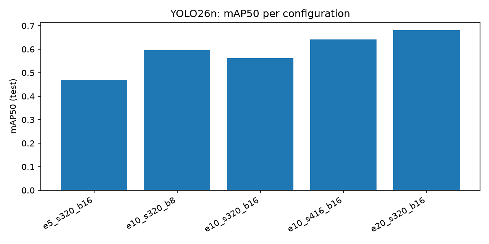
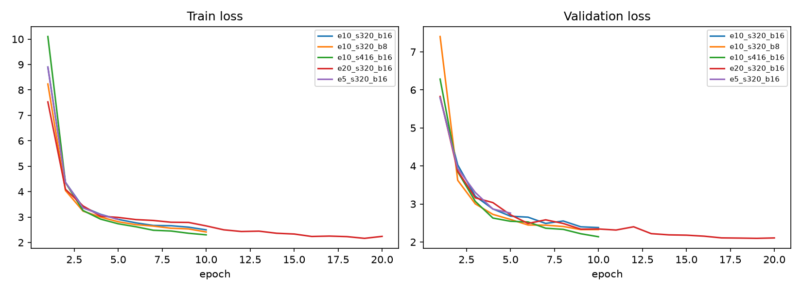
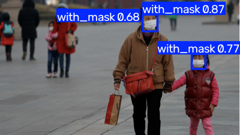

# ML-10: Object Detection II — YOLO26n สำหรับการตรวจจับหน้ากากอนามัย

**รายวิชา:** Machine Learning ([ใส่ Sec / ภาคเรียน])  
**ผู้จัดทำ:** [ชื่อ-นามสกุล] (รหัสนักศึกษา: [รหัสนักศึกษา])  
**GitHub:** [ใส่ลิงก์ ถ้ามี]

---

## 📌 บทนำ (Introduction)
โครงงานนี้เป็นส่วนหนึ่งของปฏิบัติการวิชา Machine Learning เพื่อศึกษาการตรวจจับวัตถุด้วย **YOLO (You Only Look Once)** โดยนำโมเดล **YOLO26n** ของ Ultralytics ที่ผ่านการฝึกมาแล้ว (pretrained) มาฝึกต่อ (fine-tune) เพื่อตรวจจับการสวมหน้ากากอนามัย ใช้ชุดข้อมูลเดียวกับ ML-09 แล้วเปรียบเทียบผลการฝึกด้วย **จำนวนรอบการฝึก (epochs)**, **ขนาดภาพ (image size)** และ **batch size** วัดผลด้วย Precision, Recall และ mAP บนชุด test พร้อมทดสอบกับรูปภาพ วิดีโอ และกล้องเว็บแคมแบบเรียลไทม์

การทดลองทั้งหมดรันบน **CPU** (AMD Ryzen 5 3500U ไม่มี GPU แยก) จึงจำกัดจำนวนการทดลองและจำนวน epoch ให้พอดีกับเวลาที่มี

---

## 📁 แหล่งที่มาของข้อมูล (Dataset)
- **Dataset:** Face Mask Detection (โดย andrewmvd) ชุดเดียวกับ ML-09
- **Link:** [Kaggle - Face Mask Detection](https://www.kaggle.com/datasets/andrewmvd/face-mask-detection)
- **ใบอนุญาต:** CC0: Public Domain
- **จำนวนคลาส:** 3 คลาส (`with_mask`, `without_mask`, `mask_weared_incorrect`)
- **จำนวนข้อมูล:** 853 รูป แปลงเป็นรูปแบบ YOLO (`class x_center y_center w h`) แล้ว
- **การแบ่งชุดข้อมูล (seed = 42):**
  * Training Set: 70% (597 รูป)
  * Validation Set: 15% (128 รูป)
  * Test Set: 15% (128 รูป) มีวัตถุจริง 551 ชิ้น (with_mask 461, without_mask 74, mask_weared_incorrect 16)

---

## 📁 โครงสร้างโปรเจกต์ (Project Structure)

```text
ML-10-Object-Detection-II/
├── dataset/
│   ├── train/{images,labels}/       # ชุดฝึก 597 รูป
│   ├── val/{images,labels}/         # ชุดตรวจสอบ 128 รูป
│   ├── test/{images,labels}/        # ชุดทดสอบ 128 รูป
│   └── data.yaml
├── train.py                         # ฝึก YOLO26n หลายการตั้งค่า (epochs / imgsz / batch)
├── evaluate.py                      # วัด Precision, Recall, mAP บนชุด test และสร้างตาราง/กราฟเปรียบเทียบ
├── image_test.py                    # ทดสอบกับรูปหรือวิดีโอ (เลือกโมเดลที่ mAP50 สูงสุดให้อัตโนมัติ)
├── realtime_test.py                 # ตรวจจับจากกล้องเว็บแคมแบบเรียลไทม์ พร้อมแสดง FPS
├── prepare_data.py                  # (จาก ML-09) แปลงข้อมูลเป็น YOLO และแบ่ง train/val/test
├── requirements.txt
├── README.md
├── runs/                            # ผลการฝึกและการประเมิน
│   ├── e5_s320_b16/ ... e20_s320_b16/   # แต่ละการทดลอง (weights/best.pt, results.csv, results.png ฯลฯ)
│   ├── comparison.csv               # ตารางเปรียบเทียบทุกการทดลองบนชุด test
│   ├── per_class.csv                # ผลแยกรายคลาส
│   ├── train_times.csv              # เวลาที่ใช้ฝึก
│   ├── comparison_map.png           # กราฟเปรียบเทียบ mAP50
│   └── comparison_loss.png          # กราฟ train / validation loss
└── outputs/                         # ภาพ/วิดีโอผลทำนายจาก image_test.py
```

> `train.py` สร้างไฟล์ `data_abs.yaml` (path เต็มของ dataset) ให้อัตโนมัติ และดาวน์โหลด `yolo26n.pt` ในการรันครั้งแรก

---

## ⚙️ การติดตั้งและการใช้งาน (Installation & Usage)

ทดสอบบน Python 3.13 (Windows) ด้วย CPU

1. **ติดตั้งไลบรารีที่จำเป็น:**
   ```bash
   pip install -r requirements.txt
   ```

2. **ฝึกโมเดล** (ตั้ง `QUICK_TEST = False` ใน `train.py` ก่อน; ถ้า `QUICK_TEST = True` จะฝึกแค่ 1 epoch เพื่อทดสอบ):
   ```bash
   python train.py
   ```
   สคริปต์ตรวจเองว่ามี GPU หรือไม่ ถ้ามีจะรันชุดทดลองเต็ม 7 แบบ ถ้าไม่มี (CPU) จะรันชุดเบา 5 แบบที่รายงานในเอกสารนี้ และข้ามการทดลองที่ฝึกเสร็จแล้ว

3. **ประเมินผลบนชุด test และสร้างตาราง/กราฟเปรียบเทียบ:**
   ```bash
   python evaluate.py
   ```

4. **ทดสอบกับรูป วิดีโอ และกล้อง:**
   ```bash
   python image_test.py                          # สุ่มรูปจากชุด test
   python image_test.py "path/to/image.png"      # ระบุรูป
   python image_test.py "path/to/video.mp4"      # วิดีโอ (บันทึกผลเป็นไฟล์ใน outputs/)
   python realtime_test.py                       # กล้องเว็บแคม, Q / ESC / ปุ่ม X = ออก
   ```

---

## 📊 สรุปผลการทดลอง (Experimental Results)

### 1. การตั้งค่าการทดลอง
ทุกการทดลองใช้โมเดลตั้งต้น `yolo26n.pt`, seed = 42, ฝึกด้วยรูปทั้ง 597 รูป และใช้ค่า hyperparameter อื่นตามค่าเริ่มต้นของ Ultralytics เปลี่ยนค่าทีละตัวแปร:

| ตัวแปรที่เปรียบเทียบ | การทดลอง |
| :--- | :--- |
| จำนวน epoch (ภาพ 320, batch 16) | 5 / 10 / 20 |
| ขนาดภาพ (10 epoch, batch 16) | 320 / 416 |
| batch size (10 epoch, ภาพ 320) | 8 / 16 |

### 2. ผลการประเมินบนชุด Test (128 รูป)

| การทดลอง | Epochs | Image size | Batch | Precision | Recall | mAP50 | mAP50-95 | Train loss | Val loss | เวลาฝึก (นาที) |
| :--- | :---: | :---: | :---: | :---: | :---: | :---: | :---: | :---: | :---: | :---: |
| e5_s320_b16 | 5 | 320 | 16 | 0.816 | 0.399 | 0.471 | 0.289 | 2.903 | 2.759 | 9.5 |
| e10_s320_b16 | 10 | 320 | 16 | 0.631 | 0.500 | 0.562 | 0.357 | 2.495 | 2.379 | 20.6 |
| e10_s320_b8 | 10 | 320 | 8 | 0.735 | 0.570 | 0.596 | 0.379 | 2.412 | 2.326 | 22.2 |
| e10_s416_b16 | 10 | 416 | 16 | 0.868 | 0.521 | 0.642 | 0.421 | 2.300 | 2.138 | 35.7 |
| **e20_s320_b16** | 20 | 320 | 16 | 0.725 | 0.605 | **0.681** | **0.439** | 2.239 | 2.106 | 45.4 |

- Precision / Recall เป็นค่าเฉลี่ยของ 3 คลาส ณ จุดตัดสินใจเดียวที่ Ultralytics รายงาน จึงแกว่งได้ระหว่างการทดลอง ส่วน mAP คิดจากทุกระดับความมั่นใจ จึงใช้ mAP50 เป็นตัวเปรียบเทียบหลัก
- Train / Val loss คือผลรวม loss ทุกองค์ประกอบที่ epoch สุดท้าย เปรียบเทียบข้ามขนาดภาพโดยตรงไม่ได้
- ใช้เวลาฝึกรวมประมาณ 133 นาที

### 3. ผลแยกรายคลาสของโมเดลที่ดีที่สุด (e20_s320_b16)

| คลาส | Precision | Recall | AP50 | AP50-95 |
| :--- | :---: | :---: | :---: | :---: |
| with_mask | 0.852 | 0.824 | 0.881 | 0.573 |
| without_mask | 0.775 | 0.608 | 0.671 | 0.388 |
| mask_weared_incorrect | 0.549 | 0.381 | 0.491 | 0.355 |

### 4. เปรียบเทียบกับ R-CNN และ Fast R-CNN (ML-09)

| โมเดล | mAP@0.5 บนชุด test | ความเร็วจากกล้องเว็บแคม (CPU) |
| :--- | :---: | :---: |
| R-CNN | 0.110 | ประมาณ 12-13 วินาที/เฟรม |
| Fast R-CNN | 0.156 | ประมาณ 2.9 วินาที/เฟรม |
| YOLO26n (e20_s320_b16) | 0.681 | 14.2 FPS (ประมาณ 0.07 วินาที/เฟรม) |

> เงื่อนไขไม่เหมือนกันทั้งหมด: R-CNN และ Fast R-CNN ใช้รูปฝึก 200 รูปโดยล็อกน้ำหนัก CNN และคำนวณ AP ด้วยโค้ดที่เขียนเอง ส่วน YOLO ปรับน้ำหนักทั้งโมเดลด้วยรูปฝึก 597 รูปและวัดผลด้วย Ultralytics จึงใช้ดูแนวโน้มและลำดับความเร็วได้ แต่ไม่ใช่การเทียบที่แฟร์เต็มที่ ตัวเลขความเร็วเป็นค่าที่อ่านจากการทดสอบครั้งเดียว ไม่ใช่ค่าเฉลี่ย

### 5. ผลทดสอบกับวิดีโอ
ทดสอบด้วยคลิปวิดีโอสั้นที่ถ่ายเอง (`python image_test.py "path/to/video.mp4"`) ประมวลผลได้ 343 เฟรม ใช้เวลา 19.5 วินาที (ประมาณ 17.6 เฟรม/วินาที บน CPU รวมเวลาอ่านและเขียนวิดีโอ) สคริปต์บันทึกผลเป็นวิดีโอที่วาดกรอบ ชื่อคลาส และค่าความมั่นใจลงในโฟลเดอร์ `outputs/` ตัวเลขนี้วัดต่างเงื่อนไขกับค่า FPS จากกล้องสด (14.2 FPS) จึงไม่ควรนำมาเทียบกันตรง ๆ

---

## 🖼️ แผนภาพผลลัพธ์ (Visualizations)

### เปรียบเทียบ mAP50 ของแต่ละการตั้งค่า


### กราฟ Train / Validation Loss


### ตัวอย่างผลการตรวจจับ (กรอบ ชื่อคลาส และค่าความมั่นใจ)


---

## 💡 ข้อสังเกตและวิจารณ์ผลการทดลอง (Discussion)
- **จำนวน epoch เพิ่มขึ้น ผลดีขึ้นชัดเจน:** ที่ภาพ 320 และ batch 16 mAP50 เพิ่มจาก 0.471 (5 epoch) เป็น 0.562 (10 epoch) และ 0.681 (20 epoch) โดย Recall เพิ่มตามจาก 0.399 เป็น 0.605 ขณะที่ validation loss ลดลงต่อเนื่อง (2.759 เป็น 2.106) และไม่พบสัญญาณ overfitting ในช่วง 20 epoch ที่ทดลอง เวลาฝึกเพิ่มตามจำนวน epoch ประมาณ 2 นาทีต่อ epoch บน CPU
- **ภาพขนาดใหญ่ขึ้นช่วยได้มาก แต่แลกกับเวลา:** ที่ 10 epoch การเพิ่มขนาดภาพจาก 320 เป็น 416 เพิ่ม mAP50 จาก 0.562 เป็น 0.642 (+0.080) แต่ใช้เวลาฝึกเพิ่มประมาณ 73% (20.6 เป็น 35.7 นาที) ซึ่งสมเหตุสมผลเพราะวัตถุ (ใบหน้า) ในภาพมีขนาดเล็ก ภาพความละเอียดสูงขึ้นจึงเก็บรายละเอียดได้มากกว่า
- **batch size เล็กลงดีขึ้นเล็กน้อย:** batch 8 ได้ mAP50 0.596 เทียบกับ 0.562 ของ batch 16 (+0.034) เวลาฝึกเพิ่มเพียงเล็กน้อย คาดว่าเกี่ยวกับจำนวนครั้งที่ปรับน้ำหนักต่อ epoch ที่มากขึ้นเป็นสองเท่า แต่เป็นเพียงข้อสันนิษฐาน และความต่างขนาดนี้อาจอยู่ในช่วงความแปรปรวนของการฝึกแต่ละรอบ
- **คลาสที่จำแนกยากที่สุดคือ `mask_weared_incorrect`:** ชุด test มีเพียง 16 ชิ้น AP50 จึงแกว่งมากระหว่างการทดลอง (0.095 ถึง 0.491) ส่วน `with_mask` ได้ผลดีตั้งแต่ epoch แรก ๆ (AP50 ประมาณ 0.82-0.88) เพราะเป็นคลาสที่มีตัวอย่างมากที่สุด
- **YOLO เร็วและแม่นกว่า R-CNN / Fast R-CNN มากในการทดลองนี้:** ตรวจจากกล้องได้ 14.2 FPS บน CPU เพราะประมวลผลภาพครั้งเดียวและไม่ต้องใช้ Selective Search อย่างไรก็ตามผลต่างด้าน mAP ส่วนหนึ่งมาจากเงื่อนไขการฝึกที่ต่างกัน (ดูหมายเหตุในหัวข้อ 4)
- **ข้อจำกัดของการทดลอง:** แต่ละการตั้งค่ารันเพียงรอบเดียว, เปลี่ยนค่าทีละตัวแปรเท่านั้น (ยังไม่ได้ทดสอบการผสมกัน เช่น 20 epoch กับภาพ 416 และ batch 8), ฝึกสูงสุด 20 epoch เนื่องจากข้อจำกัดของ CPU ซึ่ง loss ยังลดลงเล็กน้อยท้ายการฝึก, ชุด test มีเพียง 128 รูป, และเลือกโมเดลที่ดีที่สุดจากคะแนนบนชุด test เอง จึงอาจทำให้ตัวเลขดีเกินจริงเล็กน้อย
